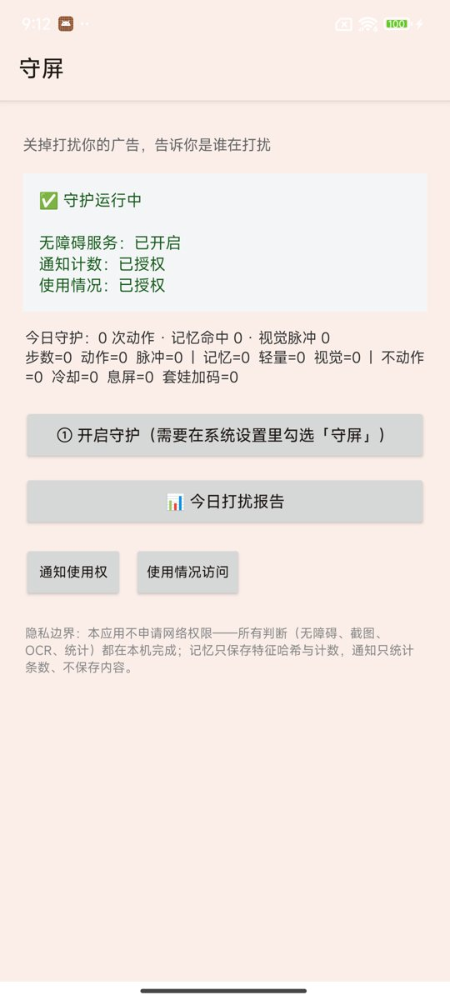
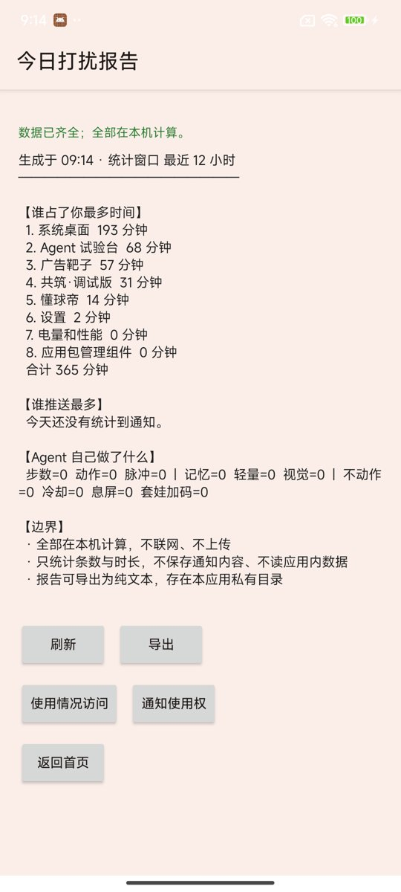
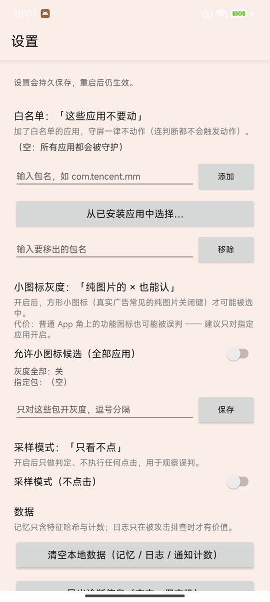
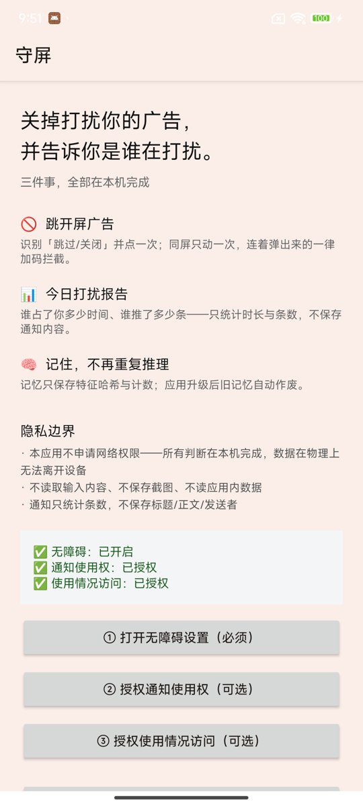

# 守屏 · ShouPing

> **关掉打扰你的广告，并告诉你是谁在打扰。**
>
> **本应用不申请 `INTERNET` 权限** —— 判断全在本机完成，数据在物理上无法离开设备。

<p>




</p>

---

## ⬇️ 下载测试版

**最新版（永久链接，始终指向最新）**

```
https://github.com/starring-ai-sec/shouping/releases/latest/download/shouping-release.apk
```

- 版本：`v0.1.0`（测试版，签名证书为本机自建）
- 大小：15.85 MB
- SHA-256：`ffb2f23cc2b24e4703a0dea3984c8271c1d6e255a52a8bb4b5259e6869488453`

**下载后请先校验**（可选，但建议）：

```powershell
# Windows
Get-FileHash .\shouping-release.apk -Algorithm SHA256
```

```bash
# macOS / Linux
shasum -a 256 shouping-release.apk
```

哈希不一致 = 文件被篡改或下载不完整，**不要安装**。

> 国内网络若打不开 GitHub 下载，见 [Releases 页面](https://github.com/starring-ai-sec/shouping/releases) 里提供的备用镜像。

---

## 一、它做什么

打开一个 App，先看 3–5 秒开屏广告；手一抖点到了电商页；关掉一个弹窗，又弹一个。

守屏做两件事：

1. **替你按掉那一下** —— 识别「跳过 / 关闭 / ×」并点击；
2. **记下证据** —— 哪个 App 弹了多少条推送、占了你多少分钟、APK 里装了哪些广告 SDK。

**不拦网络、不装模块、不改系统**，只做「看见 → 判断 → 点一下」。

---

## 二、三步开始用

| 步骤 | 做什么 | 必须吗 |
|---|---|---|
| ① | 打开**无障碍服务**（系统设置里勾选「守屏」） | **必须**，不开不会动作 |
| ② | 授权**通知使用权** | 可选（缺了报告里没有推送条数） |
| ③ | 授权**使用情况访问** | 可选（缺了报告里没有前台时长） |

另有一项可选：**显示悬浮窗**（用于「辅助跳过按钮」与「自动返回」）。
MIUI 路径：设置 → 应用设置 → 守屏 → 其他权限 → 显示悬浮窗 → 允许。

> 安装后若权限被系统重置（常见于 MIUI），需回到系统设置重新打开一次。

---

## 三、四个能力

### 1. 自动跳过开屏广告

按「便宜 → 贵」依次尝试，前一条没结果才走下一步：

| 通道 | 怎么找 | 典型场景 |
|---|---|---|
| **文案** | 读界面树里的「跳过 / 关闭 / ×」 | 原生广告、WebView 广告 |
| **OCR** | 截角区小块做**端侧**文字识别 | 自绘广告（界面树里没文字） |
| **像素** | 在角区找高对比度的角标块 | 纯图标关闭键 |
| **图标** | 找局部色块 + 与邻域亮度差大的小块 | 照片背景上的 × / 倒计时圆圈 |

每次动作前三道闸：**同窗口只动一次**、**同应用与全局都有频率上限**、**禁点名单永不作目标**（同意 / 接受 / 允许 / 授权 / 我知道了）。

界面越复杂，准入越严——**宁可漏一个，也不在你的正常界面上乱点**。

### 2. 辅助跳过按钮（需悬浮窗）

自动链路搞不定时，右下角出现小胶囊「跳过广告」**3.5 秒后自动消失**。

- 点它 = 由无障碍执行关闭；找不到可信目标就发一次返回键；
- 限流，不会变成常驻按钮；
- **你不点，它什么都不做。**

### 3. 自动返回（需悬浮窗，**默认关闭**）

不用点，直接发返回键。**默认关闭**——它是唯一会「退出应用」的动作，误退的代价远高于多关一个广告。

只在同时满足时才动：应用刚启动、界面是极简的开屏形态（不是内容页）、视觉确实跑过、这个应用以前真被关过广告、你几秒内没摸屏幕。

**误退自愈**：发出后校验真实前台，若把你退到桌面 → 判定误退 → **本机从此不再对该应用自动返回**。最多误退一次。

### 4. 打扰报告 + 成分透视

- **打扰报告**：谁占了你最多时间、弹了多少条推送；
- **成分透视**：扫描前台应用 APK，看它装了哪些广告 SDK（内置常见广告 SDK 指纹库）。

---

## 四、隐私边界（可核验，不是口号）

| 设计 | 怎么自己验证 |
|---|---|
| **不申请网络权限** | `aapt2 dump badging shouping-release.apk \| grep uses-permission` → 列表里没有 `android.permission.INTERNET` |
| **记忆只存哈希** | `adb shell run-as com.cobuild.guard cat files/agent-memory.txt` → 只有 `T\|pkg\|sceneHash\|featHash\|...` |
| **通知只计数** | `shared_prefs/notify_counts.xml` 只有「日期 \| 包名 → 次数」，无标题无正文 |
| **截图不落盘** | 正式构建已关闭调试落盘；只有手动打开调试开关才会写文件 |
| **诊断信息不自动上传** | 「设置 → 导出诊断信息」由你在系统文件选择器里决定存哪、发给谁 |

详细核验步骤：[`docs/隐私核验.md`](./docs/隐私核验.md)

---

## 五、已知限制（Beta 很诚实）

1. **签名证书是本机自建的** —— 将来换正式证书时，需要**卸载重装**（Android 不允许签名不同的覆盖安装），**本地数据会清除**；
2. **上不了应用商店** —— 依赖无障碍服务做非无障碍用途，Google Play 与多数国内商店不接受，只能侧载；本仓库是唯一官方分发渠道；
3. **Flutter / 游戏类应用**：代码在 `libapp.so` 里，扫不到 dex，成分透视会是空的——这是事实，不是 bug；
4. **部分广告创意关不掉**：退出控件不是「跳过 / 关闭 / ×」文案时，会走像素或图标通道；仍可能失败；
5. **release 包读不到日志**（去掉了 debuggable）—— 排查请用「设置 → 导出诊断信息」；
6. **MIUI / 华为等系统**：授权跳转会二次确认（系统行为）。

---

## 六、常见问题

**Q：为什么需要无障碍权限？**
A：它只能「读界面 + 点一下」，这是识别「跳过」按钮的唯一途径。守屏**不做输入监听**，不读取你打的字。

**Q：会不会把我的数据传出去？**
A：应用没有网络权限，操作系统层面禁止它建立任何网络连接。你可以用上面第 4 节的命令自己验证。

**Q：误点了怎么办？**
A：有禁点名单（同意 / 接受 / 允许 / 授权 / 我知道了… 永不点击）+ 频率上限 + 同窗口只动一次。自动返回还有「误退自愈」——退错一次就永久拉黑那个应用。

**Q：为什么不在应用商店？**
A：见「已知限制」第 2 条。

---

## 七、反馈

- 提 Issue：请附「设置 → 导出诊断信息」生成的文本（**里面不含你的输入内容**）；
- 反馈崩溃/误点：请注明机型、系统版本、目标 App 包名。

---

## 八、声明

- 本仓库**只分发编译产物**，不开源源码；
- 免费使用，无广告、无内购、无统计上报；
- 请勿用于绕过付费内容、破解、或任何违反目标应用服务条款的用途。

<p align="right"><sub>守屏 v0.1.0 · 2026-11</sub></p>
